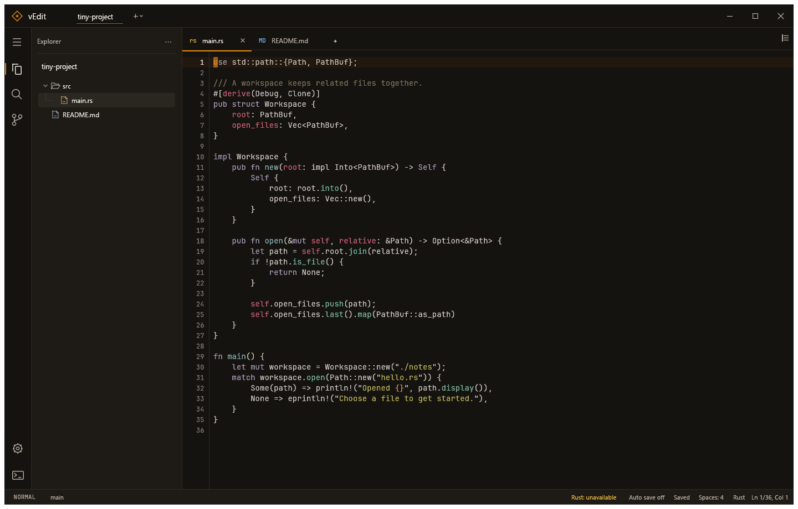

# vEdit 0.4.20

Ein nativer Code-Editor für Windows mit mehreren Projekten, Vim-Bedienung, Git und Sprachunterstützung für Rust, Python und Dart. Projektordner, offene Dateien, Cursorpositionen und Einstellungen werden beim nächsten Start wiederhergestellt. Die Oberfläche verwendet englische Beschriftungen.

Version 0.4.20 beschleunigt das Bearbeiten großer Dateien, die Projektsuche, Explorer, Git-Verlauf und -Graph sowie Markdown-Tabellen und die Anzeige von Taskausgaben. Die [Performance-Untersuchung](docs/performance-audit-0.4.20.md) dokumentiert die gemessenen Verbesserungen und verbleibenden Engpässe.

Version 0.4.19 verbessert die Agentenbedienung: Jeder CLI-Befehl hat eine eigene Hilfe, `schema OP` zeigt gezielt seine JSON-Beispiele, und Textdateien lassen sich direkt als Entwurf laden oder revisionsgeschützt in einen Puffer übernehmen. UTF-16-Dateien mit BOM aus Windows PowerShell werden akzeptiert. Lange Pufferzeilen und Taskausgaben lassen sich vollständig weiterlesen. Der Agenten-Skill enthält die häufigen Abläufe direkt und trennt die Spezialthemen.

Version 0.4.18 ergänzt die geteilte Git-Ansicht mit verschiebbarer Trennlinie, lokalen und entfernten Commits, Branch-Wechsel und genauen Zeitangaben. Die Statusleiste bietet mehr Platz und richtet Modus, Branch und Speicherstatus einheitlich aus. Der Explorer markiert das Ziel eines Rechtsklicks deutlich und kann Dateien und Ordner in den Windows-Papierkorb verschieben. Seit Version 0.4.17 heißt Morrow **vEdit** und übernimmt das Farbschema von vBot und Watchtower: warmes Graphit, helle cremefarbene Schrift und Orange für Aktionen und Auswahl. Grün, Gelb, Blau und Rot kennzeichnen weiterhin Erfolg, Warnungen, Informationen und Fehler.

Bestehende Sitzungen mit Projekten, Einstellungen, Fensterpositionen und ungespeicherten Entwürfen werden weiterverwendet. Die Programme heißen jetzt `vedit.exe` und `vedit-cli.exe`; der Starter heißt **vEdit.lnk**. Eine bereits laufende Morrow-Version bleibt bis zum normalen Schließen geöffnet. Beim nächsten Start über den neuen Starter erscheint vEdit.



## Starten

Zum direkten Start **vEdit.lnk** im Projektordner doppelklicken. Die portable Anwendung liegt unter **`dist/vEdit/vedit.exe`** und lässt sich auch dort direkt starten. Zum Bearbeiten von Textdateien ist keine Rust-Installation erforderlich. Für Git-Funktionen muss `git` im `PATH` liegen; Rust-Werkzeuge werden für Rust-Projekte benötigt.

Zum Bauen aus dem Quellcode: Rust mit dem stabilen Windows-Toolchain installieren und im Projektordner ausführen:

```powershell
cargo build --release
.\target\release\vedit.exe
```

Alternativ startet `cargo run --release` die Anwendung. Ein Ordner oder eine Datei kann beim Start als Argument übergeben werden:

```powershell
.\dist\vEdit\vedit.exe "C:\Code\MeinProjekt"
```

Beim ersten Start mit **Ctrl+Shift+O** Projektordner hinzufügen. **Ctrl+O**, das Hinzufügen von Projekten und **Save as…** verwenden die nativen Windows-Dialoge. Beim Öffnen können mehrere Dateien beziehungsweise Projektordner ausgewählt werden. Links oben zwischen Projekten wechseln, im Explorer Dateien öffnen oder mit **Ctrl+P** nach Dateinamen und Pfaden suchen. Die Dateiauswahl hat eine dauerhaft sichtbare Scrollleiste; Pfeiltasten, **Home**, **End** und **Page Up/Down** bewegen die Auswahl. **Esc** oder ein Klick außerhalb schließt die Auswahl. **Ctrl+Shift+P** öffnet die Befehlspalette; dort sind auch Aktionen ohne Tastenkürzel erreichbar.

Die Projekt-Tabs sitzen oben neben dem Namen der App und wechseln per Klick direkt zum Projekt. Ein gelber Punkt zeigt uncommittete Git-Änderungen; der Tooltip nennt die Anzahl. Saubere Projekte erhalten keinen Punkt. Auch inaktive Projekte werden im Hintergrund aktualisiert. Viele Projekte lassen sich horizontal durchscrollen; Tastenkürzel machen den aktiven Tab sichtbar. Der **+**-Knopf beziehungsweise **Ctrl+Alt+P** öffnet die durchsuchbare Projektliste; Namen, Pfade sowie offene und geänderte Dateien helfen bei der Auswahl. Pfeiltasten und **Enter** wechseln direkt zum Projekt, **Esc** schließt die Liste. **Ctrl+Alt+PageDown** / **Ctrl+Alt+PageUp** wechseln zum nächsten beziehungsweise vorherigen offenen Projekt. Jedes Projekt besitzt eigene Tab-Leisten, Ansichten und Splits, die beim Wechsel zusammen mitwechseln und nach einem Neustart wiederhergestellt werden. Die Dateien bleiben geöffnet und ungespeicherte Änderungen erhalten. Weitere Projektordner lassen sich über die Liste mit dem nativen Dialog hinzufügen. Im Explorer steht der aktive Projektname als feste Überschrift über seinem Dateibaum.

## Arbeiten im Editor

Der Knopf mit drei Strichen ganz links über dem Explorer öffnet das Hauptmenü mit **File**, **View** und **Run**. Er bleibt auch ohne geöffnetes Projekt erreichbar. Windows verwendet eine einzelne vEdit-Titelleiste: freie Flächen ziehen das Fenster, ein Doppelklick maximiert beziehungsweise stellt es wieder her. Rechts liegen Minimieren, Maximieren/Wiederherstellen und Schließen; bei ungespeicherten Änderungen fragt vEdit vor dem Schließen nach. Die Fensterränder lassen sich weiterhin ziehen, **Alt+Space** öffnet das Windows-Fenstermenü, und der Maximieren-Knopf unterstützt die Windows-Snap-Auswahl.

- Gleichnamige Tabs erhalten einen kurzen Ordnerzusatz, etwa `lib.rs — client\src`; eindeutig benannte Dateien bleiben kompakt. Auch gleichnamige offene Projekte lassen sich im Projektwechsel links oben anhand ihres Ordners unterscheiden.
- Der Speicherzustand bleibt in der Statusleiste sichtbar: **Saved**, **Unsaved**, **Saving…**, **Agent draft** oder ein Dateifehler. **Auto save on/off** schaltet das automatische Speichern für alle Projekte um. Neue Dateien und Agent-Entwürfe warten weiter auf **Ctrl+S**; der Tooltip erklärt die jeweilige Situation.
- Syntaxfarben, Zeilennummern, aktuelle Zeile und Dateipfad helfen bei der Orientierung. Die Statusleiste zeigt aktuelle Zeile / Gesamtzeilen und die Cursorspalte; Zeilenumbruch verändert die Gesamtzahl nicht.
- JetBrains Mono Regular wird mitgeliefert und ist die Standardschrift für Code: klare Zeichen, etwas mehr Zeilenabstand und Syntaxfarben ohne zusätzliche Kursivschrift oder Unterstreichungen. Unter **Settings → Editor font** stehen außerdem die Windows-Schriften Consolas und Cascadia Mono zur Wahl; fehlt eine Systemschrift, wird die mitgelieferte Schrift verwendet. Schriftgröße und Schriftwahl werden gespeichert.
- Ein Klick setzt den Cursor. Ziehen und Doppelklick wählen Text aus, ein Dreifachklick ganze Zeilen. Beim Ziehen am sichtbaren Rand scrollt der Editor vertikal und horizontal mit, auch bei stillgehaltener Maus; bei Zeilenumbruch nur vertikal. Im Vim-Normalmodus wird daraus eine Visual-Auswahl; im Insert-Modus bleibt die Texteingabe aktiv.
- Im Insert-Modus oder bei ausgeschaltetem Vim sucht **Ctrl+F** in der Datei; **Ctrl+H** öffnet Suchen und Ersetzen. Im Normalmodus startet `/` die Vim-Suche. Groß-/Kleinschreibung und ganze Wörter lassen sich in Find/Replace einstellen; dort wird nach wörtlichem Text gesucht.
- **Ctrl+Shift+F** durchsucht das aktive Projekt. Ein Treffer öffnet die passende Datei, zeigt die Fundstelle mittig und hebt die Zielzeile kurz hervor.
- **Settings** (**Ctrl+,**) gruppiert Lese-, Layout-, Speicher- und Vim-Einstellungen. **Interface zoom** vergrößert die gesamte Oberfläche einschließlich Explorer, Git und Vorschau (75–200 %); **Ctrl++ / Ctrl+−** ändern den Zoom, **Ctrl+0** stellt 100 % wieder her, auch im Einstellungsdialog. Unabhängig davon sind Codeschriftgröße (10–32), Zeilenabstand (1–2×), absolute/relative/ausgeschaltete Zeilennummern und die Hervorhebung der Cursorzeile einstellbar. Dazu kommen Einrückungsbreite, Zeilenumbruch, **Smooth scrolling**, Vim, Leader-Taste und Autosave samt Verzögerung. Änderungen wirken sofort und werden gespeichert. Vim und Autosave sind standardmäßig eingeschaltet, weiches Scrollen ist ausgeschaltet.
- Bei Zeilenumbruch bleibt die Zeilennummer an der ersten sichtbaren Reihe einer Quelltextzeile stehen; Fortsetzungen bekommen keine zusätzliche Nummer.
- **Ctrl+Z** sowie **Ctrl+Y** / **Ctrl+Shift+Z** verwenden mit eingeschaltetem Vim dieselbe Undo-Historie wie `u` / **Ctrl+R**, auch im Insert- und Visual-Modus. Im Insert-Modus bleibt die Texteingabe aktiv; Vim-Register und System-Zwischenablage bleiben getrennt.
- Im Insert-Modus oder bei ausgeschaltetem Vim: **Tab** springt zur nächsten Einrückungsposition, **Shift+Tab** rückt aus, **Ctrl+/** schaltet Zeilenkommentare um. **Alt+↑/↓** verschiebt Zeilen oder ausgewählte Zeilenblöcke; **Alt+Shift+↓** dupliziert sie. Beide Aktionen erhalten Cursor beziehungsweise Vim-Auswahl und sind rückgängig machbar. Neue Zeilen übernehmen die Einrückung.

Dateiindex, Dateizugriffe, Projektsuche, Git und Sprachanalyse laufen im Hintergrund. Auch die Suche in großen offenen Dateien berechnet ihre Treffer im Hintergrund; währenddessen zeigt sie **Searching…** und verwirft überholte Ergebnisse bei weiterer Eingabe oder einem Dateiwechsel. Der Explorer zeigt auch ignorierte und generierte Projektdateien. Er liest jeden geöffneten Ordner vollständig und lädt Unterordner erst beim Aufklappen; ein begrenzter Quick-Open-Index kann daher keine Explorer-Dateien ausblenden. VCS-Metadaten wie `.git` bleiben verborgen. Die Projektsuche bietet unter **Exclusions** eine gespeicherte Liste von Ordnern und Dateimustern, etwa `src/generated` oder `**/*.min.js`. Sie liest unabhängig vom Explorer den Datenträger; eine leere Filterliste erlaubt auch generierte Ordner, während `.gitignore` und VCS-Verzeichnisse weiter berücksichtigt werden. Die Projektsuche verfolgt symbolische Links nicht. Ihre Ressourcenlimits und die des Quick-Open-Index bleiben als Hinweise sichtbar.

Rechtsklick auf Dateien und Ordner markiert den betroffenen Eintrag über die ganze Zeile; sein Name steht zusätzlich im Menü. Die aktive Datei bleibt separat erkennbar. Das Menü bietet Öffnen, seitliches Öffnen, neue Dateien oder Ordner, Umbenennen, **Delete**, Pfade kopieren und Anzeigen im Windows-Explorer. **Delete** beziehungsweise **Entf** im fokussierten Explorer verschiebt das gewählte Element in den Windows-Papierkorb; dort lässt es sich wiederherstellen. Ungespeicherte Dokumente und Agent-Entwürfe im betroffenen Pfad verhindern das Löschen. Netzwerkpfade und Verknüpfungen werden nicht dauerhaft gelöscht, sondern mit einer Meldung abgelehnt. Auf der freien Fläche im Explorer lassen sich neue Dateien und Ordner direkt im Projekt anlegen; dort sind auch Projektpfad, Windows-Explorer, Aktualisieren und **Collapse all** erreichbar. **Collapse all** im Explorer-Menü klappt die Ordner des aktiven Projekts ein. Tab-Menüs bieten Speichern, Save as, Splits und Schließen; **Close saved tabs** erhält geänderte Dokumente. Im Editor stehen Ausschneiden, Kopieren, Einfügen, Auswahl und Undo/Redo im Kontextmenü bereit.

**Ctrl+Shift+T**, **File → Reopen closed tab** oder die gleichnamige Palettenaktion öffnet zuletzt geschlossene Dateien des aktiven Projekts im aktuellen Editorbereich. Cursorposition und Markdown-Ansicht kommen zurück. Jedes Projekt merkt sich bis zu 20 Dateien bis zum Schließen des Projekts oder der Anwendung. Bereits anderweitig offene Dateien behalten ihren aktuellen, auch ungespeicherten Text; sonst wird die aktuelle Datei vom Datenträger geladen. Bewusst verworfene Änderungen und nie gespeicherte Entwürfe werden nicht wiederhergestellt.

Im fokussierten Explorer navigieren Pfeiltasten oder `h j k l`; **Enter** öffnet die Datei, **Home/End** und **Page Up/Down** bewegen sich durch längere Listen. **F2** startet Umbenennen mit ausgewähltem Dateinamen ohne Erweiterung; bei Ordnern wird der ganze Name ausgewählt. **Shift+F10** öffnet das Kontextmenü des ausgewählten Eintrags.

Der Explorer sortiert Ordner vor Dateien und macht die Hierarchie mit dezenten Verbindungslinien sichtbar. Dateinamen stehen in einheitlichen Spalten; Auswahl und aktive Datei bleiben über die gesamte Zeilenbreite lesbar. Ignorierte Dateien benötigen keinen Sichtbarkeitsschalter. **Ctrl+O** öffnet Dateien direkt; **Ctrl+P** verwendet einen eigenen Suchindex.

## Seitenleisten einrichten

Explorer, Suche, Source control und Review lassen sich unabhängig links oder rechts anordnen. Jede Seite zeigt genau einen aktiven Inhalt. Die Symbole ganz links wechseln zur jeweiligen Ansicht auf ihrer zugeordneten Seite. Explorer und Git können nebeneinander oder beide auf derselben Seite liegen; auf derselben Seite ersetzt ein Wechsel den sichtbaren Inhalt. Der Seitenleistenkopf zeigt nur den Namen der aktiven Ansicht und ihre Aktionen. Beide Seiten können auch leer oder ausgeblendet bleiben. **Ctrl+Alt+B** blendet nur rechts aus oder ein; **Ctrl+Alt+E** tut dasselbe links. Beide Kürzel funktionieren auch im Vim-Normalmodus. Das **×** im Seitenleistenkopf blendet die ganze Seite aus, ohne die Zuordnung zu verändern. Ziehen an der Innenkante ändert ihre Breite.

Das **⋯**-Menü des aktiven Panels bietet **Move panel to left/right**, **Hide panel** und **Show …** für weitere Ansichten derselben Seite. **View → Arrange sidebar panels…** und **Settings → Layout** bieten dieselbe Zuordnung und Sichtbarkeit. Zuordnung, aktive Ansicht und Breiten werden gespeichert; bisherige Sitzungen werden übernommen. Bei schmalen Fenstern begrenzt vEdit die Breiten zugunsten des Editors. Reicht der Platz nicht für beide Seiten, erscheint ein Hinweis zum Wechseln der vorübergehend ausgeblendeten Seite; das gespeicherte Layout bleibt erhalten.

## Bereiche für Agenten markieren

Text mit der Maus oder Vim `v` / `V` auswählen und **Leader a** oder **Ctrl+Shift+A** drücken. Der Ausschnitt bleibt als zusätzliche lila Markierung erhalten; weitere Bereiche können in beliebigen Dateien und Projekten hinzukommen. Die gewöhnliche Auswahl und das Vim-Register bleiben erhalten. Das **×** am Rand entfernt einen Bereich. Das Symbol **For agent** in der Tab-Leiste zeigt die Gesamtzahl; **Leader A** oder **Ctrl+Alt+Shift+A** öffnet die gemeinsame Übersicht mit Dateigruppen, Suche, optionalen Notizen, **Clear all** und **Restore last**.

Die Markierung enthält den Text zum Zeitpunkt der Auswahl, einschließlich ungespeicherter Änderungen. Bei Änderungen vor dem Bereich wandert sie mit; Änderungen innerhalb des Bereichs kennzeichnen den gespeicherten Ausschnitt als veraltet, statt einen anderen Text als ursprünglich ausgewählt auszugeben. Geschlossene Dateien und Projektwechsel löschen die Sammlung nicht.

Die Übersicht zeigt die tatsächlich enthaltenen Zeilen und die Zeichenanzahl. Bei **Restore last** steht sichtbar, wie viele entfernte oder von einem Agenten abgeholte Bereiche zurückkommen. Die letzte Entfernung, **Clear all** oder Abholung bestimmt das Ziel; neue Markierungen und Notizen bleiben beim Wiederherstellen erhalten.

Agenten lesen die Sammlung mit `vedit-cli agent-marks`. Mit `agent-marks take` holen sie die Bereiche ab und entfernen die lila Markierungen; die letzte abgeholte Sammlung bleibt über Neustarts hinweg wiederherstellbar. Große Sammlungen und lange Ausschnitte werden vollständig über Folgeseiten geliefert. Die Anleitung gehört zum [Repository-Skill](.agents/skills/vedit/SKILL.md), der auch im portablen Paket enthalten ist.

## Tastenkürzel

| Aktion | Tastenkürzel |
| --- | --- |
| Projektordner hinzufügen | Ctrl+Shift+O |
| Offenes Projekt auswählen | Ctrl+Alt+P |
| Nächstes / vorheriges Projekt | Ctrl+Alt+PageDown / Ctrl+Alt+PageUp |
| Datei über Dialog öffnen | Ctrl+O |
| Datei im Projekt finden | Ctrl+P |
| Befehlspalette | Ctrl+Shift+P |
| Explorer fokussieren | Ctrl+Shift+E |
| Aktiven Editorbereich fokussieren | Ctrl+1 |
| Sichtbare Seitenleisten, Editorbereiche und Output durchlaufen | F6 / Shift+F6 |
| Räumlich links / rechts / oben / unten fokussieren | Ctrl+Alt+← / → / ↑ / ↓ |
| Aktuellen Tab in einen benachbarten Split verschieben | Ctrl+Alt+Shift+← / → / ↑ / ↓ |
| Git / Output fokussieren | Ctrl+Shift+G / Ctrl+Alt+O |
| Neue Datei | Ctrl+N¹ |
| Aktuelle Datei speichern | Ctrl+S |
| Alle geänderten Dateien speichern | Ctrl+Shift+S |
| Tab schließen | Ctrl+W |
| Geschlossenen Tab wieder öffnen | Ctrl+Shift+T |
| Nächster / vorheriger Tab | Ctrl+Tab / Ctrl+Shift+Tab |
| Suchen / Ersetzen in der Datei | Ctrl+F² / Ctrl+H |
| Nächster / vorheriger Treffer | F3 / Shift+F3 |
| Projekt durchsuchen | Ctrl+Shift+F |
| Zu einer Zeile springen | Ctrl+G |
| Linke Seitenleiste ein-/ausblenden | Ctrl+Alt+E oder Ctrl+B² |
| Rechte Seitenleiste ein-/ausblenden | Ctrl+Alt+B |
| Oberfläche vergrößern / verkleinern / zurücksetzen | Ctrl++ / Ctrl+− / Ctrl+0 |
| Ausgabe öffnen | Ctrl+` oder View → Output |
| Zeilenumbruch umschalten | Alt+Z |
| Editor nach rechts / unten teilen | Ctrl+\ / Ctrl+Shift+\ |
| Aktuellen Editorbereich schließen | Ctrl+Alt+W |
| Einstellungen | Ctrl+, |
| Vervollständigung anfordern | Ctrl+Space |
| Zur Definition springen | F12 oder `gd` im Vim-Normalmodus |
| Fehler und Warnungen anzeigen | Ctrl+Shift+M |
| Auswahl für einen Agenten markieren | Ctrl+Shift+A oder Leader a |
| Agent-Markierungen öffnen | Ctrl+Alt+Shift+A oder Leader A |
| Interaktives Terminal im Projekt öffnen | Run → Open terminal |
| Aktives Projekt prüfen | F5 |
| Aktive Datei ausführen | Ctrl+F5 |
| Projekttests starten | Alt+F6 |

¹ Im Vim-Insert-Modus fordert **Ctrl+N** stattdessen Vervollständigung an. Neue Dateien sind auch über **File → New file** erreichbar.

² Wenn der Vim-Normal- oder Visualmodus im Editor aktiv ist, blättern **Ctrl+F** und **Ctrl+B** eine Seite weiter/zurück. Suche mit `/`, die Befehlspalette oder **View → Explorer** bleiben erreichbar.

## Eigene Tastenkürzel und räumlicher Fokus

**Settings → Keyboard** oder die Palettenaktion **Keyboard shortcuts** öffnet das durchsuchbare Befehlsverzeichnis. Auf eine Belegung klicken, die neue Kombination drücken; **Esc** bricht die Aufnahme ab. **Disable**, **Reset** und **Reset all** deaktivieren beziehungsweise restaurieren Belegungen. Konflikte werden mit dem betroffenen Befehl erklärt. Auch Aktionen ohne Standardkürzel sind belegbar. Änderungen gelten sofort und bleiben nach Neustarts erhalten; Menüs und Palette zeigen die aktuelle Belegung. Die hier genannten Kombinationen sind die Standardwerte. Textnavigation, Zwischenablage und einzelne Vim-Motions behalten ihre normale Eingabebedeutung.

**Ctrl+Alt+Pfeiltasten** wechseln anhand der sichtbaren Anordnung zwischen beiden Seitenleisten, Editor-Splits und dem unteren Ausgabebereich. Die Rückkehr in den Editor berücksichtigt die vorherige Zeile beziehungsweise Spalte der Splits. **F6 / Shift+F6** durchlaufen sichtbare Bereiche; ausgeblendete Seitenleisten werden dabei nicht geöffnet. **Ctrl+Alt+Shift+Pfeiltasten** verschieben den aktiven Tab in einen benachbarten Editor-Split. **Ctrl+Tab / Ctrl+Shift+Tab** wechseln Tabs im aktiven Bereich. Alle diese Befehle sind neu belegbar.

In Git bewegen **↑↓ / Home / End** den Fokus, **←→** öffnen und schließen Ordner, **Enter** öffnet Diff oder Commit. **Tab** erreicht Stage-/Unstage-Schaltflächen und Commit-Eingabe. Pfeile und Enter bleiben innerhalb der Commit-Nachricht normale Texteingaben. Der sichtbare Fokus kehrt nach dem Schließen eines Git-Diffs zurück.

## Vim

Neue und geöffnete Dateien beginnen im **Normalmodus**. `i` wechselt zum Schreiben in den **Insert-Modus**, **Esc** führt zurück. Der aktuelle Modus steht unten in der Statusleiste. Wer normale Texteditor-Bedienung bevorzugt, kann **Vim motions** in den Einstellungen ausschalten.

**Settings → Swap J and K** tauscht die Bewegungsrichtungen von `j` und `k`, einschließlich Anzahl, Operatoren und Visual-Auswahl. Die Einstellung gilt auch für die Navigation im Explorer und das Scrollen der Markdown-Vorschau. Eingetippter Text und Buchstaben als Ziel von `f`, `t` oder `r` bleiben unverändert; Pfeil- und Seitentasten behalten ihre Richtung.

**Ctrl+C**, **Ctrl+X** und **Ctrl+V** bedienen die Windows-Zwischenablage auch im Vim-Modus. Kopieren erhält Modus und Auswahl; ohne Auswahl wird die aktuelle Zeile kopiert. Ausschneiden ist rückgängig machbar. Einfügen im Normalmodus setzt den Text direkt an die Cursorposition und verändert das Vim-Register nicht. `y`, `d`, `p` und `P` verwenden weiterhin die Vim-Bedienung; `p` setzt Registertext hinter, `P` vor den Cursor, bei kopierten Zeilen unterhalb beziehungsweise oberhalb der aktuellen Zeile.

**Space** ist die Standard-Leader-Taste. Im Normal- und Visual-Modus öffnet sie eine kurze Hilfe: **Space m** setzt oder entfernt einen Bookmark an der aktuellen Zeile, **Space b** öffnet die durchsuchbare Bookmark-Liste. Bookmarks speichern Datei, Zeile und Cursorposition, bleiben beim Schließen einer Datei und nach Neustarts erhalten und können benannt oder entfernt werden. Im Picker lässt sich zwischen aktuellem Projekt und allen Bookmarks wechseln; die Markierung erscheint auch im Editor-Gutter. Kleine Verschiebungen werden beim Anspringen anhand der gespeicherten Quelltextzeile berücksichtigt. **Settings → Leader key** bietet Space, Komma und Backslash; die CLI erlaubt auch andere einzelne Zeichen. Im Insert-Modus bleibt Space ein normales Leerzeichen.

**Space Space f** startet den Bildschirm-Sprung. Ein bis drei Zeichen eingeben, etwa `gi`: vollständig sichtbare Treffer werden hervorgehoben und erhalten numerische Labels. Das Label tippen, um den Cursor dorthin zu bewegen; mehrstellige Labels haben eine feste Länge, etwa `03`. Weitere Buchstaben verfeinern die Suche, **Backspace** korrigiert sie, **Esc** bricht ab. Für numerischen Suchtext zuerst **Enter** drücken, um die Suche festzulegen, und danach das Label eingeben. Im Visual-Modus erweitert der Sprung die bestehende Auswahl. Die Suche wirkt auf den aktiven Editorbereich und verändert keinen Text. Bookmarks und Bildschirm-Sprung sind auch über das Menü und die Befehlspalette erreichbar.

`v` startet eine Zeichenauswahl; `V` (**Shift+V**) wählt ganze Zeilen. Mit Bewegungen erweitern, dann beispielsweise `y` kopieren, `d` löschen, `c` ändern oder `>` / `<` ein-/ausrücken. **Esc** beendet die Auswahl.

| Aufgabe | Beispiele |
| --- | --- |
| Bewegen | `h j k l`, `w b e ge`, `W B E gE` |
| Zeilen- und Dateigrenzen | `0 ^ $ g_`, `gg`, `G`, `42G`, `8\|`, `Enter`, `+` / `-` |
| Klammern / Absätze | `%`, `{`, `}` |
| Zeichen in der Datei finden | `f` / `F`, `t` / `T` suchen über Zeilengrenzen hinweg; `;` wiederholt, `,` sucht in Gegenrichtung |
| Einfügen | `i a I A`, `o O` |
| Löschen / Ändern | `x`, `dd`, `dw`, `cw`, `cc`, `D`, `C`, `r` + Zeichen |
| Kopieren / Einfügen | `yy`, `yw`, `p`, `P` |
| Anzahl voranstellen | `3w`, `2dd`, `d2w`, `2d3w` |
| Textobjekte | `ciw`, `daw`, `di(`, `ca{`, `yi"`, `viw` |
| Klammern und Anführungszeichen | `ysiw)` umschließt ein Wort, `yss"` eine Zeile; `ds"` entfernt, `cs"'` ersetzt; im Visual-Modus `S` + Zeichen |
| Einrücken / Zeilen verbinden | `>>`, `<<`, `J`; `gJ` verbindet ohne zusätzliche Leerzeichen |
| Groß-/Kleinschreibung | `~`, `guw`, `gUiw`, `g~$`; in Visual `u`, `U`, `~` |
| Letzte Änderung wiederholen | `.`; auch Insert-Änderungen werden erfasst |
| Rückgängig / Wiederholen | `u` / Ctrl+R |
| Blättern | Ctrl+F / Ctrl+B; Ctrl+D / Ctrl+U für halbe Seiten |
| Suchen | `/` sucht vorwärts, `?` rückwärts; `n` wiederholt die Richtung, `N` kehrt sie um. `*` / `#` suchen das Wort unter dem Cursor |

Das unbenannte Kopierregister wird zwischen Tabs geteilt: etwa in einer Datei `yy`, in einer anderen `p`. Es bleibt von der Systemzwischenablage getrennt. Jeder Tab hat seine eigene Undo-Historie; eine zusammenhängende Insert-Änderung wird als Schritt behandelt.

Die Vim-Suche springt schon während der Eingabe zum Treffer und markiert alle sichtbaren Ergebnisse. **Enter** bestätigt und gibt den Editor frei, **Esc** bricht ab und stellt die Ausgangsposition wieder her. Eine leere bestätigte Eingabe wiederholt das letzte Suchmuster. Im Visual-Modus erweitert die Suche die Auswahl; `n` und `N` unterstützen Zählwerte wie `3n`. `:noh` blendet die Treffer-Markierungen aus und behält das Suchmuster für den nächsten Sprung.

**↑/↓** beziehungsweise **Ctrl+P/N** in der Vim-Suche rufen bestätigte Suchmuster auf; die aktuelle Eingabe bleibt beim Zurückkehren erhalten. **Ctrl+W** löscht das Wort vor dem Cursor, **Ctrl+U** den Anfang der Eingabe. **Shift+Enter** in Find springt zum vorherigen Treffer.

Die Zeichensuche `f` / `F` und `t` / `T` reicht bis zum Datei-Ende beziehungsweise Datei-Anfang und funktioniert auch mit Zählwerten, Auswahlen und Operatoren wie `dfx` oder `cfx`. `;` wiederholt die ursprüngliche Richtung, `,` sucht einmal in Gegenrichtung; die Zeichensuche bleibt unabhängig vom Suchmuster für `n` / `N`. `.` wiederholt Textänderungen. `p` / `P` fügen aus dem Vim-Register ein; im Visual-Modus behält `P` dessen Inhalt für weitere Einfügungen bei.

**Space p** fügt das zuletzt mit `y` kopierte Stück ein, auch nachdem `d` oder `c` das unbenannte Register überschrieben haben. Dasselbe geht mit `"0p` beziehungsweise `"0P`, auch mit Zählwerten und im Visual-Modus. Das Yank-Register `0` wird wie das unbenannte Register zwischen Tabs geteilt und bleibt unabhängig von der Systemzwischenablage.

Die grundlegenden Surround-Befehle unterstützen `()` / `[]` / `{}` / `<>` sowie einfache, doppelte und Backtick-Anführungszeichen. Ein schließendes Zeichen wie `)` umschließt direkt, ein öffnendes wie `(` fügt innen Leerzeichen hinzu. Bewegungen, Textobjekte, Auswahlen und `.` sind kombinierbar; jede abgeschlossene Änderung bildet einen Undo-Schritt. XML-Tag-Eingabe und benutzerdefinierte Surround-Vorlagen sind nicht enthalten.

**Zweimal Esc kurz hintereinander** blendet Suchmarkierungen aus. Das Suchmuster bleibt erhalten; `n`, `N` oder eine neue Suche aktivieren die Markierungen wieder. Vim-Yanks heben den kopierten Bereich kurz hervor; `yy` markiert dabei die ganze Zeile.

Die Suche unterscheidet standardmäßig Groß- und Kleinschreibung. `\c` im Muster ignoriert sie, `\C` erzwingt sie. Reguläre Ausdrücke verwenden die Rust-Regex-Syntax, etwa `foo|bar`, `\w`, `^` und `$`; der vollständige Vim-Regex-Dialekt und Such-Offsets sind nicht enthalten. Die normale Find/Replace-Leiste sucht weiterhin nach wörtlichem Text.

Über `:` stehen diese Befehle zur Verfügung:

- `:w` speichern, `:wa` alle geänderten Dateien speichern.
- `:q` Tab schließen, `:wq` / `:x` speichern und schließen.
- `:q!` Tab schließen und ungespeicherte Änderungen verwerfen.
- `:e src/main.rs` eine Datei relativ zum Projekt öffnen.
- `:42` zu Zeile 42 springen; `:noh` die Treffer-Markierungen ausblenden.
- `:bn` / `:bp` zum nächsten beziehungsweise vorherigen Tab wechseln; `:new` eine Datei anlegen.
- `:split` / `:vsplit` den Editor unterhalb beziehungsweise rechts teilen; optional folgt ein Dateipfad.
- `:set wrap` / `:set nowrap` den Zeilenumbruch einstellen; `number`, `nonumber` und `relativenumber` steuern Zeilennummern.
- `:s/alt/neu/` ersetzt den ersten Treffer der aktuellen Zeile; `:%s/alt/neu/g` ersetzt alle Treffer im Dokument. Bereiche wie `:2,8s/alt/neu/g` und die Visual-Auswahl sind möglich. `i` ignoriert Groß-/Kleinschreibung, `I` erzwingt sie, `n` zählt ohne Änderung, `e` erlaubt null Treffer. Muster verwenden wie die Vim-Suche Rust-Regex-Syntax; `&` und `\1` bis `\9` setzen Treffer und Gruppen in der Ersetzung ein. `\r` erzeugt einen Zeilenumbruch. Die Änderung bildet einen Undo-Schritt; ungültige Muster oder nicht unterstützte Flags verändern keinen Text. Interaktive Bestätigung mit `c` ist nicht enthalten.

Die `:`-Befehlszeile besitzt ebenfalls einen Verlauf mit **↑/↓**, der die aktuelle Eingabe beim Zurückkehren erhält.

vEdit implementiert einen eigenen Vim-Kern. Visual-Block, Makros, weitere benannte Register, Vimscript, Neovim-Plugins und das vollständige Ex-Befehlssystem sind nicht enthalten.

## Markdown lesen

Markdown-Dateien bieten rechts in der Tab-Leiste ein Vorschau-Symbol. Es leuchtet, wenn die Vorschau aktiv ist; ein Klick oder **Ctrl+Alt+M** wechselt zwischen Quelltext und Vorschau. Der Quelltext bleibt ein normaler Vim-Editor; **Shift+V** wählt weiterhin ganze Zeilen aus.

Bei langen Vorschauen bleibt die vertikale Scrollleiste sichtbar. Breite Tabellen zeigen auch ohne Mausbewegung eine horizontale Scrollleiste; kurze Dokumente und passende Tabellen benötigen keine zusätzliche Leiste.

Die Vorschau zeigt Überschriften, Listen, Aufgaben, Tabellen, Zitate, Codeblöcke und Links. Text ist auswählbar; Codeblöcke lassen sich kopieren. Ein Doppelklick auf einen Block öffnet die passende Quelltextzeile. In der Vorschau scrollen `j` / `k`, **Ctrl+D** / **Ctrl+U**, `gg` und **Shift+G**. Bilder werden als Links angezeigt, HTML bleibt Text. Die Ansicht wird pro Datei beim Neustart wiederhergestellt.

## Geteilte Ansicht

**View → Split right** oder **Split down** teilt den Editor. Der neue Bereich beginnt mit der aktuellen Datei und verwaltet seine eigene Tab-Leiste. Dateien öffnen, **Ctrl+Tab**, **Ctrl+W**, **Close others** und **Close saved tabs** wirken auf diesen Bereich. Wenn sein letzter Tab geschlossen wird, verschwindet der Split; der letzte Editorbereich bleibt als leere Arbeitsfläche bestehen.

Jeder Bereich hat seine eigene Navigation und Scrollposition. Unterschiedliche Dateien können nebeneinander stehen; bei Markdown sind auch Quelltext und Vorschau derselben Datei möglich. Beide Ansichten bearbeiten denselben Text und teilen dessen Undo-Historie. Ein Tab schließt nur seine Ansicht: Ist die Datei noch in einem anderen Bereich offen, bleiben ungespeicherter Text und Undo erhalten. Die Trennlinie lässt sich ziehen. **Next region** und **Previous region** wechseln zwischen sichtbaren Seitenleisten, Editorbereichen und Output; **Ctrl+Alt** mit einer Pfeiltaste fokussiert den benachbarten Bereich in dieser Richtung. **Close pane** entfernt den Bereich und übernimmt seine sonst nirgends offenen Tabs in den verbleibenden Bereich.

Tabs lassen sich mit der Maus innerhalb einer Tab-Leiste umsortieren oder in einen anderen Bereich verschieben. Ein Einfügemarker zeigt die Position; auch die Dokumentfläche des Zielbereichs nimmt Tabs an. Wird der letzte Tab aus einem Bereich verschoben, schließt sich dieser Bereich. Der Text, ungespeicherte Änderungen und Undo bleiben erhalten. **Esc** oder Loslassen außerhalb eines Zielbereichs bricht das Ziehen ab.

## Mit Agenten arbeiten

**`dist/vEdit/vedit-cli.exe`** steuert das laufende Fenster und startet vEdit bei `open`, `review` oder `workspace`, falls es geschlossen ist. Befehle liefern JSON mit echten Tab-IDs, Revisionen, Ladezustand und Fehlern. Agenten können die offenen Dokumente lesen und bearbeiten, Ansichten anordnen und ihre Ergebnisse zeigen:

```powershell
.\dist\vEdit\vedit-cli.exe open "C:\Code\Projekt\plan.md" --preview
.\dist\vEdit\vedit-cli.exe review "C:\Code\Projekt\review.json"
.\dist\vEdit\vedit-cli.exe tabs
.\dist\vEdit\vedit-cli.exe focus 12 --line 42 --source
.\dist\vEdit\vedit-cli.exe bookmarks
.\dist\vEdit\vedit-cli.exe bookmarks toggle --tab 12 --label "Review this section"
.\dist\vEdit\vedit-cli.exe bookmarks jump 1
.\dist\vEdit\vedit-cli.exe read 12 --line 1 --count 50
.\dist\vEdit\vedit-cli.exe request ".\editor-action.json"
.\dist\vEdit\vedit-cli.exe --help
.\dist\vEdit\vedit-cli.exe read --help
.\dist\vEdit\vedit-cli.exe schema edit
```

`new [TITLE] --file TEXTDATEI` erstellt einen ungespeicherten Entwurf. `edit TAB_ID --file TEXTDATEI --revision N` ersetzt den gesamten Pufferinhalt durch den vorbereiteten Text; für gezielte Bereiche bleibt `request` verfügbar. `save-as TAB_ID PFAD --revision N` speichert unter einem noch nicht vorhandenen Ziel. Text- und JSON-Dateien akzeptieren UTF-8 mit oder ohne BOM sowie UTF-16 mit BOM; Zeilenenden bleiben im Text erhalten. In Windows PowerShell setzt `[Console]::OutputEncoding = [Text.UTF8Encoding]::new($false)` die Dekodierung der CLI-Ausgabe auf UTF-8.

`read` und `output` liefern bei weiteren Textteilen `next_line` und `next_column`; diese Werte gehen an `--line` und `--column`. Bei `byte_limit_reached:true` schließen die Textteile direkt aneinander an. Zwischen vollständigen `read`-Zeilenpaketen ist ein Zeilenumbruch einzufügen; `output` enthält seine Trennzeichen bereits. Beim Zusammensetzen eines Puffers muss die Revision gleich bleiben.

Tab- und Bereichs-IDs kommen aus den Antworten und gelten für den laufenden App-Prozess. Die oben gezeigte `12` ist ein Beispiel. `request` führt strukturierte JSON-Aktionen aus; `schema` zeigt deren aktuelle Formen und Vorgaben.

| Bereich | Verfügbare Kontrolle |
| --- | --- |
| Dokumente | Öffnen, neue Entwürfe, offenen Text lesen, Änderungen, Suchen/Ersetzen, Auswahl, Undo/Redo, Speichern und Save as |
| Dateien | Dateien und Ordner umbenennen, neue Ordner erstellen, Abschluss und Fehler der Hintergrundoperation abfragen |
| Ansichten | Fokus, Cursorposition, Source/Preview, Splits erstellen, Tabs sortieren oder zwischen Bereichen verschieben, Dokumente zuweisen, Bereiche fokussieren, schließen und skalieren |
| Editoraktionen | Einrücken, Kommentare umschalten, Zeilen duplizieren/löschen, Treffer wechseln, unveränderte Dateien neu laden |
| Einstellungen | Vim, Leader, Such- und Explorer-Filter, Autosave samt Verzögerung, UI-Zoom, Schrift, Zeilenabstand/-nummern, Cursorzeile, Einrückung, Umbruch und Scrollen lesen oder gezielt ändern |
| Bookmarks | Gespeicherte Stellen auflisten, setzen, benennen, entfernen und anspringen |
| Projektarbeit | Inhaltsuche, Git-Status, Branches und History lesen, Branch wechseln, Diagnosen, Diff zum gespeicherten Text, Build/Test/Check starten oder stoppen, Ausgabe lesen |
| Präsentation | Mehrere Dateien mit Hinweisen öffnen, Review-Seitenleiste, Markierungen entfernen, Panels zeigen oder ausblenden |

Textänderungen verlangen `expected_revision` aus der vorherigen Antwort. Eine falsche Revision verändert den Text nicht. Mehrere nicht überlappende Edit-Bereiche beziehen sich auf dieselbe Ausgangsfassung und werden gemeinsam als Undo-Schritt angewendet. Edit- und Auswahlbereiche haben ein **exklusives Ende**; Review-Markierungen unten haben ein **inklusives Ende**. Agentenänderungen bleiben zunächst ungespeichert, auch bei eingeschaltetem Autosave. Erst ein explizites Speichern gibt sie für die Datei frei.

`search QUERY [WORKSPACE]` übernimmt die gespeicherten Suchfilter. Wiederholtes `--exclude PATTERN` ersetzt sie für diese eine Suche, `--no-excludes` entfernt die optionalen Filter; `.gitignore` bleibt wirksam. Die JSON-Form bietet `excludes`, etwa `{"op":"search","query":"needle","excludes":[]}`. Die Antwort nennt die verwendeten Filter und deren Herkunft. Eine Suche im anderen Projekt verändert den sichtbaren Projektfokus nicht. Dauerhaft ändern lassen sich die Filter mit `settings` und `search_excludes`; `settings swap-jk true` tauscht die J/K-Richtung. Weggelassene Einstellungen bleiben unverändert.

`batch` führt bekannte Aktionen in Reihenfolge aus und stoppt standardmäßig beim ersten Fehler. Bereits ausgeführte Schritte werden nicht zurückgerollt; ihre Ergebnisse stehen in der Antwort. Neu erhaltene IDs oder Revisionen müssen ausgelesen werden, bevor abhängige Schritte gesendet werden.

Ein Review-Manifest kann mehrere Dateien und mehrere Hinweise je Datei enthalten. Pfade im Manifest beziehen sich auf dessen Ordner. Zeilen und Unicode-Zeichenspalten beginnen bei 1; ein angegebenes Ende ist inklusive. Ohne Ende wird die ganze Startzeile markiert.

```json
{
  "title": "Plan und wichtige Aenderungen",
  "note": "Bitte zuerst den Plan lesen.",
  "files": [
    { "path": "plan.md", "view": "preview" },
    {
      "path": "src/main.rs",
      "annotations": [
        {
          "start": { "line": 42 },
          "note": "Hier beginnt die neue Behandlung.",
          "severity": "info"
        }
      ]
    }
  ]
}
```

Die Seitenleiste **Review** zeigt die Dateien und Hinweise mit ausgeschriebener Dringlichkeit (**Info**, **Warning**, **Critical**). Ein Klick springt zur betreffenden Stelle; Markierungen stören die Vim-Auswahl nicht. Nach eigenen Änderungen werden veraltete Markierungen ausgeblendet und ein Hinweis angezeigt. **Clear** entfernt die Hinweise und lässt die Tabs offen.

`open` und `review` erhalten ungespeicherten Text. Unveränderte offene Dateien werden dabei im Hintergrund vom Datenträger aktualisiert. `close` lehnt geänderte oder noch speichernde Tabs ab. Öffnen, Laden und Speichern sind getrennte Zustände; eine erfolgreiche Anfrage allein bedeutet nicht, dass eine Datei bereits geladen oder geschrieben wurde. Die Verbindung bleibt lokal und ist pro Sitzung authentifiziert.

Der Agenten-Skill gehört zum Repository und liegt unter [.agents/skills/vedit/SKILL.md](.agents/skills/vedit/SKILL.md). Die portable Anwendung enthält eine Kopie unter `skills/vedit/`. Er erklärt die Bedienung und wie der Agent prüft, ob die angeforderten Änderungen und Dokumente tatsächlich bereit sind; eine persönliche Installation ist nicht erforderlich.

## Speichern und Wiederherstellung

**Ctrl+S** speichert die aktive Datei, **Ctrl+Shift+S** alle geänderten Dateien. Neue Dateien und **File → Save as…** öffnen den Windows-Speicherdialog, auch außerhalb des Projekts. Eine vorhandene Zieldatei wird erst nach der Windows-Bestätigung ersetzt; spätere Änderungen auf dem Datenträger bleiben durch die Konfliktprüfung geschützt. Eine Datei, die bereits in einem anderen Tab offen ist, lässt sich nicht als Ziel überschreiben. Abbrechen erhält den ungespeicherten Text.

Automatisches Speichern schreibt benannte Dateien standardmäßig nach **850 ms Schreibpause**. In Settings lässt sich die Verzögerung auf **300–5000 ms** ändern oder Autosave ausschalten. Wiederherstellungskopien werden unabhängig davon weiterhin nach 850 ms für geänderte Dateien und neue Tabs geschrieben, auch für neu angelegte Agent-Entwürfe ohne weitere Eingabe. Sie liegen unter `%APPDATA%\vEdit\recovery` (bei bestehenden Installationen weiterhin `%APPDATA%\Morrow\recovery`) und werden beim nächsten Start eingelesen. Text, ursprünglicher Dateistand und Zeilenumbruchformat werden zusammen gesichert. Externe Änderungen nach einem Absturz werden durch die wiederhergestellten Edits nicht überschrieben; bei einem Konflikt erhält **Save as…** beide Fassungen. Ältere Wiederherstellungskopien ohne verlässlichen Vergleichsstand bleiben lesbar und schützen die ursprüngliche Datei ebenfalls. Vorübergehend nicht verfügbare Projekte behalten ihre wiederherstellbaren Entwürfe. Beim regulären Schließen fragt vEdit nach ungespeicherten Änderungen.

Dateien werden über eine temporäre Datei im selben Ordner atomar gespeichert. Änderungen auf dem Datenträger werden vor dem Ersetzen geprüft; ein Konflikt überschreibt die externe Version nicht. Unveränderte offene Dateien werden bei externen Änderungen aktualisiert. Bei eigenen Änderungen den Inhalt mit **Save as…** sichern, bevor die externe Fassung erneut geöffnet wird. **Reload file from disk** in der Befehlspalette lädt eine unveränderte Datei neu.

Unterstützt werden **UTF-8-Textdateien bis 8 MiB**, einschließlich UTF-8-BOM und LF-, CRLF-, CR- sowie gemischter Zeilenenden. **Save as…** erhält gemischte Zeilenenden anhand der unveränderten Originaldatei, unabhängig vom bisherigen Inhalt des Ziels. Ist das Original inzwischen geändert oder nicht mehr verfügbar, wird die Kopie mit LF gespeichert; ein Statushinweis erklärt den Wechsel. Binärdateien und andere Textkodierungen werden beim Öffnen mit einer Meldung abgelehnt. Wiederherstellungskopien ergänzen das Speichern und ersetzen keine Projekt-Backups.

## Sprachen und Projektbefehle

**Python, Dart und Rust** haben Diagnosen, Vervollständigung und Navigation zur Definition. Jede Sprache erhält im Projekt ihre eigene Analysesitzung; auch gemischte Projekte funktionieren. **Ctrl+Space** fordert Vorschläge an, **F12** beziehungsweise Vim `gd` springt zur Definition. Die Statusleiste zeigt den Zustand der aktiven Sprache. **Problems** (**Ctrl+Shift+M**) enthält Fehler, Warnungen und Serverzustände. **Restart language analysis** verbindet die aktuelle Sprache neu, ohne eigene Änderungen zu verwerfen.

Die portable Ausgabe bringt **basedpyright und Node** für Python mit. Ein vorhandener Projekt- oder PATH-Sprachserver wird bevorzugt. Unter **Settings → Tasks** lässt sich der Python-Interpreter wählen; automatisch werden `.venv`, `venv`, `env` und anschließend PATH berücksichtigt. Derselbe Interpreter gilt für Ausführung und Analyse. Dart verwendet das installierte Dart- oder Flutter-SDK. Rust verwendet `rust-analyzer` (`rustup component add rust-analyzer rust-src`).

**Settings → Languages** bietet aktivierbare Vorgaben und zusätzliche eigene Sprachserver: Dateiendungen, Sprache, Programm, separate Argumente und bei Bedarf JSON-Einstellungen. Serveränderungen werden mit **Apply and restart language** übernommen. Dateien bleiben auch ohne Server normal editierbar. Syntaxfarben, Dateityperkennung und Kommentare erkennen insbesondere auch `.pyi`, `.pyw` und Großschreibung; Dart besitzt eine eigene Syntaxgrammatik.

**Settings → Editing** steuert Einrückung. Neue Python-Dateien verwenden vier, Dart-Dateien zwei Leerzeichen. Vorhandene Einrückung wird automatisch erkannt; diese Erkennung lässt sich ausschalten. Breite und Tab-Verwendung sind je Sprache überschreibbar. Die Statusleiste zeigt die tatsächlich verwendete Einstellung und öffnet sie per Klick. Einstellungen ändern zukünftige Eingaben; vorhandener Text wird nicht automatisch umformatiert.

**Run → Run active file** (**Ctrl+F5**), **Check project** (**F5**), **Run tests** (**Alt+F6**) und **Build project** passen sich der aktiven Sprache an. Python verwendet den gewählten Interpreter, Dart das SDK, Rust Cargo. Unter **Settings → Tasks** lassen sich Profil und Befehle pro Projekt überschreiben; andere Sprachen können dort eigene Befehle erhalten. Python-Tests verwenden standardmäßig pytest, Python-Builds das Modul build. Vor dem Start müssen betroffene Dokumente gespeichert sein; vEdit zeigt offene Speicherarbeit an und bietet **Save all files**. Agent-Entwürfe werden dabei nicht stillschweigend freigegeben.

## Git und Befehle

Git betrachtet den gespeicherten Dateistand. Bei ungespeicherten Dokumenten zeigt Source control deren Anzahl und **Save all files**; auch offene Ordner desselben Repositorys werden berücksichtigt. Nach dem Speichern müssen die gewünschten Änderungen weiterhin gestaged werden. Speichern löst keinen Commit aus.

Automatische Git-Abfragen zeigen eine ruhige Punktanzeige, damit der Editor im Leerlauf nicht ständig neu zeichnet. Änderungen werden weiterhin automatisch aktualisiert.

**View → Source control** zeigt **Changes** oben und **History** darunter. Ziehen an der horizontalen Trennlinie verteilt den Platz zwischen beiden Bereichen; die Höhe wird pro Projekt gespeichert. Doppelklick setzt die Aufteilung zurück. Beide Bereiche scrollen unabhängig. Änderungen stehen als Ordnerbaum getrennt nach **Staged**, **Changes** und **Untracked**, mit hinzugefügten und entfernten Zeilen pro Datei. Eine teilweise gestagte Datei erscheint in beiden passenden Gruppen mit den jeweiligen Zahlen. Binärdateien werden als solche angezeigt; für große unversionierte Dateien können die Zahlen fehlen.

Ein Klick auf eine Änderung öffnet ihren Diff mit alten und neuen Zeilennummern und lesbarem Funktionskontext. Lange Zeilen werden auf die Fensterbreite umbrochen; ihre Zeilennummern stehen nur an der ersten Teilzeile. Dateiinformationen und technische Patch-Details stehen getrennt im Kopfbereich; **Copy patch** kopiert den vollständigen Originalpatch. Das Kontextmenü bietet Datei öffnen, Pfad kopieren sowie Stage/Unstage; ganze Ordner lassen sich gemeinsam vorbereiten. Gestagte Änderungen werden mit einer Commit-Nachricht committed. Über den Branch-Namen oben lässt sich ein lokaler Branch auswählen oder aus einem Remote-Branch ein lokaler Tracking-Branch erstellen. Ungespeicherte Dokumente oder Git-Konflikte verhindern den Wechsel; Änderungen werden weder verworfen noch automatisch gestasht. **Fetch**, **Pull** und **Push** stehen im Repository-Menü. Pull verwendet `--ff-only`; Zugangsdaten werden über die vorhandene Git-Konfiguration verwaltet.

**History** zeigt einen Commit-Graphen mit Verzweigungen und Zusammenführungen. Jeder Eintrag zeigt die Commit-Nachricht und den Autor, darunter Branch-Namen einschließlich **HEAD**. Orange markiert ausschließlich lokale Commits, Blau die von einem Remote-Branch erreichbaren Commits. Der Remote-Stand entspricht dem letzten **Fetch**. Im Hover stehen Datum und Uhrzeit mit Zeitzone sowie das relative Alter (etwa **12 minutes ago**), vollständige Metadaten, Branch-Bezeichnungen, die Anzahl geänderter Dateien und hinzugefügte/entfernte Zeilen in Grün/Rot. Diese Zahlen werden im Hintergrund geladen und zwischengespeichert; bei Merge-Commits beziehen sie sich auf den ersten Eltern-Commit. Ein Klick auf einen Commit öffnet Autor, Datum, vollständige Nachricht, Hash, Eltern und einen Dateibaum mit Zeilenzahlen. Beim Scrollen werden ältere Einträge automatisch nachgeladen. Die Historie bleibt beim Lesen stabil; bei neuen Commits oder verschobenen Branches bietet **History changed · Refresh** den Wechsel zum neuen Stand an. Die Dateien in den Commit-Details öffnen den historischen Diff dieses Commits. Ein Klick außerhalb oder **Esc** schließt jeweils die oberste Ansicht. Alle Git-Abfragen laufen im Hintergrund. Commit-Details werden zwischengespeichert und große Diffs rendern nur ihre sichtbaren Zeilen.

Im Bereich **Output** lassen sich zusätzlich eigene Befehle im aktiven Projektordner starten. Sie verwenden die ausgewählte Python-Umgebung. Ausgabe und Rückgabestatus erscheinen dort; **Stop** beendet einen laufenden Befehl einschließlich seiner Unterprozesse. Eigene Befehle können `VEDIT_ROOT`, `VEDIT_FILE` und `VEDIT_PYTHON` als Umgebungsvariablen verwenden; Dateipfade werden nicht in Shellcode interpoliert.

Der Ausgabebereich ist ein Befehlsstarter mit Ausgabeanzeige. Interaktive Eingabe, Terminal-Anwendungen und Passwortabfragen sind dort nicht unterstützt. Befehle haben ein Zeitlimit von zehn Minuten; die Ausgabe wird begrenzt. **Run → Open terminal** öffnet für interaktive Arbeit ein separates PowerShell-Fenster im aktiven Projektordner. **Open terminal** ist ebenfalls in der Befehlspalette verfügbar.

vEdit bietet derzeit keinen Debugger, VS-Code-Erweiterungsmarkt, Mehrfachcursor oder vollständigen VS-Code-Funktionsumfang.

## Prüfen

```powershell
cargo test --all-targets -- --test-threads=8
```

Die Tests decken Bearbeitung, Vim, Dateizugriffe, Wiederherstellung, Git, CLI, Befehlsausführung und die Oberfläche ab. SDK-abhängige Integrationstests und manuelle Benchmarks sind standardmäßig übersprungen. Beispielsweise lässt sich der Test mit einem echten rust-analyzer nach Installation der Rust-Komponenten explizit ausführen:

```powershell
cargo test live_rust_analyzer_diagnostics_completion_and_definition -- --ignored --nocapture
```

Build, gezielte Tests, Bildreferenzen und portable Pakete beschreibt die [Entwicklungsanleitung](docs/development.md). Repository-Agenten beginnen mit [AGENTS.md](AGENTS.md); die Bedienung einer laufenden vEdit-Instanz erklärt der separate [vEdit-Skill](.agents/skills/vedit/SKILL.md).
