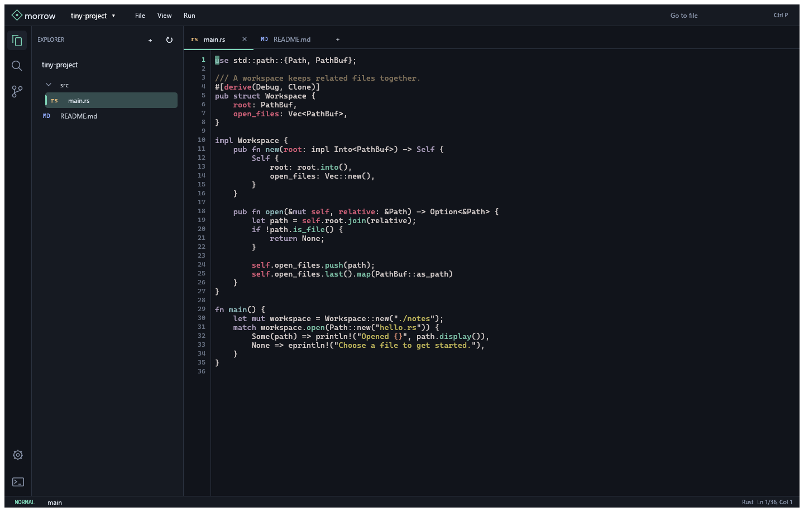

# Morrow 0.4.5

Ein nativer Code-Editor für Windows mit mehreren Projekten, Vim-Bedienung, Git und Rust-Sprachunterstützung. Projektordner, offene Dateien, Cursorpositionen und Einstellungen werden beim nächsten Start wiederhergestellt. Die Oberfläche verwendet englische Beschriftungen.



## Starten

Zum direkten Start **Morrow.lnk** im Projektordner doppelklicken. Die portable Anwendung liegt unter **`dist/Morrow/morrow.exe`** und lässt sich auch dort direkt starten. Zum Bearbeiten von Textdateien ist keine Rust-Installation erforderlich. Für Git-Funktionen muss `git` im `PATH` liegen; Rust-Werkzeuge werden für Rust-Projekte benötigt.

Zum Bauen aus dem Quellcode: Rust mit dem stabilen Windows-Toolchain installieren und im Projektordner ausführen:

```powershell
cargo build --release
.\target\release\morrow.exe
```

Alternativ startet `cargo run --release` die Anwendung. Ein Ordner oder eine Datei kann beim Start als Argument übergeben werden:

```powershell
.\dist\Morrow\morrow.exe "C:\Code\MeinProjekt"
```

Beim ersten Start mit **Ctrl+Shift+O** Projektordner hinzufügen. **Ctrl+O**, das Hinzufügen von Projekten und **Save as…** verwenden die nativen Windows-Dialoge. Beim Öffnen können mehrere Dateien beziehungsweise Projektordner ausgewählt werden. Links oben zwischen Projekten wechseln, im Explorer Dateien öffnen oder mit **Ctrl+P** nach Dateinamen und Pfaden suchen. Die Dateiauswahl hat eine dauerhaft sichtbare Scrollleiste; Pfeiltasten, **Home**, **End** und **Page Up/Down** bewegen die Auswahl. **Esc** oder ein Klick außerhalb schließt die Auswahl. **Ctrl+Shift+P** öffnet die Befehlspalette; dort sind auch Aktionen ohne Tastenkürzel erreichbar.

Der Projektwechsel sitzt links oben neben dem Namen der App. **Ctrl+Alt+P** öffnet die durchsuchbare Liste; Namen, Pfade sowie offene und geänderte Dateien helfen bei der Auswahl. Pfeiltasten und **Enter** wechseln direkt zum Projekt, **Esc** schließt die Liste. **Ctrl+Alt+PageDown** / **Ctrl+Alt+PageUp** wechseln zum nächsten beziehungsweise vorherigen offenen Projekt. Jedes Projekt besitzt eigene Tab-Leisten, Ansichten und Splits, die beim Wechsel zusammen mitwechseln und nach einem Neustart wiederhergestellt werden. Die Dateien bleiben geöffnet und ungespeicherte Änderungen erhalten. Weitere Projektordner lassen sich über die Liste mit dem nativen Dialog hinzufügen. Im Explorer steht der aktive Projektname als feste Überschrift über seinem Dateibaum.

## Arbeiten im Editor

- Syntaxfarben, Zeilennummern, aktuelle Zeile und Dateipfad helfen bei der Orientierung. Die Statusleiste zeigt aktuelle Zeile / Gesamtzeilen und die Cursorspalte; Zeilenumbruch verändert die Gesamtzahl nicht.
- Ein Klick setzt den Cursor. Ziehen und Doppelklick wählen Text aus, ein Dreifachklick ganze Zeilen. Im Vim-Normalmodus wird daraus eine Visual-Auswahl; im Insert-Modus bleibt die Texteingabe aktiv.
- Im Insert-Modus oder bei ausgeschaltetem Vim sucht **Ctrl+F** in der Datei; **Ctrl+H** öffnet Suchen und Ersetzen. Im Normalmodus startet `/` die Vim-Suche. Groß-/Kleinschreibung und ganze Wörter lassen sich in Find/Replace einstellen; dort wird nach wörtlichem Text gesucht.
- **Ctrl+Shift+F** durchsucht das aktive Projekt. Ein Treffer öffnet die passende Datei, zeigt die Fundstelle mittig und hebt die Zielzeile kurz hervor.
- **Settings** (**Ctrl+,**) bietet Vim an/aus, die Leader-Taste, automatisches Speichern, Schriftgröße, Einrückungsbreite, Zeilenumbruch und **Smooth scrolling**. Vim und automatisches Speichern sind standardmäßig eingeschaltet; weiches Scrollen ist standardmäßig ausgeschaltet und lässt sich für Editor und Markdown-Vorschau aktivieren.
- Bei Zeilenumbruch bleibt die Zeilennummer an der ersten sichtbaren Reihe einer Quelltextzeile stehen; Fortsetzungen bekommen keine zusätzliche Nummer.
- Im Insert-Modus oder bei ausgeschaltetem Vim: **Tab** rückt ein, **Shift+Tab** rückt aus, **Ctrl+/** schaltet Zeilenkommentare um und **Alt+Shift+↓** dupliziert Zeilen. Neue Zeilen übernehmen die Einrückung.

Dateiindex, Dateizugriffe, Projektsuche, Git und Rust-Analyse laufen im Hintergrund. Auch die Suche in großen offenen Dateien berechnet ihre Treffer im Hintergrund; währenddessen zeigt sie **Searching…** und verwirft überholte Ergebnisse bei weiterer Eingabe oder einem Dateiwechsel. Der Explorer berücksichtigt `.gitignore` und überspringt unter anderem `.git`, `target`, `node_modules` und generierte Build-Ordner. Die Projektsuche bietet unter **Exclusions** eine gespeicherte Liste von Ordnern und Dateimustern, etwa `src/generated` oder `**/*.min.js`. Sie liest unabhängig vom Explorer-Index den Datenträger; eine leere Filterliste erlaubt auch generierte Ordner, während `.gitignore` und VCS-Verzeichnisse weiter berücksichtigt werden. Symbolische Links werden nicht verfolgt. Bei erreichten Such- oder Indexgrenzen erscheint ein Hinweis; dann hilft ein kleinerer Projektordner oder eine genauere Suche.

Rechtsklick auf Dateien und Ordner bietet Öffnen, seitliches Öffnen, neue Dateien oder Ordner, Umbenennen, Pfade kopieren und Anzeigen im Windows-Explorer. Auf der freien Fläche im Explorer lassen sich neue Dateien und Ordner direkt im Projekt anlegen; dort sind auch Projektpfad, Windows-Explorer und Aktualisieren erreichbar. Tab-Menüs bieten Speichern, Save as, Splits und Schließen; **Close saved tabs** erhält geänderte Dokumente. Im Editor stehen Ausschneiden, Kopieren, Einfügen, Auswahl und Undo/Redo im Kontextmenü bereit.

Im fokussierten Explorer navigieren Pfeiltasten oder `h j k l`; **Enter** öffnet die Datei, **Home/End** und **Page Up/Down** bewegen sich durch längere Listen. **F2** startet Umbenennen mit ausgewähltem Dateinamen ohne Erweiterung; bei Ordnern wird der ganze Name ausgewählt. **Shift+F10** öffnet das Kontextmenü des ausgewählten Eintrags.

## Tastenkürzel

| Aktion | Tastenkürzel |
| --- | --- |
| Projektordner hinzufügen | Ctrl+Shift+O |
| Offenes Projekt auswählen | Ctrl+Alt+P |
| Nächstes / vorheriges Projekt | Ctrl+Alt+PageDown / Ctrl+Alt+PageUp |
| Datei über Dialog öffnen | Ctrl+O |
| Datei im Projekt finden | Ctrl+P |
| Befehlspalette | Ctrl+Shift+P |
| Explorer fokussieren | Ctrl+Shift+E |
| Aktiven Editorbereich fokussieren | Ctrl+1 |
| Explorer und Editorbereiche vorwärts / rückwärts fokussieren | F6 / Shift+F6 |
| Benachbarten Editorbereich fokussieren | Ctrl+Alt+← / → / ↑ / ↓ |
| Neue Datei | Ctrl+N¹ |
| Aktuelle Datei speichern | Ctrl+S |
| Alle geänderten Dateien speichern | Ctrl+Shift+S |
| Tab schließen | Ctrl+W |
| Nächster / vorheriger Tab | Ctrl+Tab / Ctrl+Shift+Tab |
| Suchen / Ersetzen in der Datei | Ctrl+F² / Ctrl+H |
| Nächster / vorheriger Treffer | F3 / Shift+F3 |
| Projekt durchsuchen | Ctrl+Shift+F |
| Zu einer Zeile springen | Ctrl+G |
| Seitenleiste ein-/ausblenden | Ctrl+B² |
| Ausgabe öffnen | Ctrl+` oder View → Output |
| Zeilenumbruch umschalten | Alt+Z |
| Editor nach rechts / unten teilen | Ctrl+\ / Ctrl+Shift+\ |
| Aktuellen Editorbereich schließen | Ctrl+Alt+W |
| Einstellungen | Ctrl+, |
| Rust-Vervollständigung anfordern | Ctrl+Space |
| Zur Rust-Definition springen | F12 oder `gd` im Vim-Normalmodus |
| Fehler und Warnungen anzeigen | Ctrl+Shift+M |
| Interaktives Terminal im Projekt öffnen | Run → Open terminal |
| `cargo check` starten | F5 |
| `cargo test` starten | Alt+F6 |

¹ Im Vim-Insert-Modus fordert **Ctrl+N** stattdessen Vervollständigung an. Neue Dateien sind auch über **File → New file** erreichbar.

² Wenn der Vim-Normal- oder Visualmodus im Editor aktiv ist, blättern **Ctrl+F** und **Ctrl+B** eine Seite weiter/zurück. Suche mit `/`, die Befehlspalette oder **View → Explorer** bleiben erreichbar.

## Vim

Neue und geöffnete Dateien beginnen im **Normalmodus**. `i` wechselt zum Schreiben in den **Insert-Modus**, **Esc** führt zurück. Der aktuelle Modus steht unten in der Statusleiste. Wer normale Texteditor-Bedienung bevorzugt, kann **Vim motions** in den Einstellungen ausschalten.

**Settings → Swap J and K** tauscht die Bewegungsrichtungen von `j` und `k`, einschließlich Anzahl, Operatoren und Visual-Auswahl. Die Einstellung gilt auch für die Navigation im Explorer und das Scrollen der Markdown-Vorschau. Eingetippter Text und Buchstaben als Ziel von `f`, `t` oder `r` bleiben unverändert; Pfeil- und Seitentasten behalten ihre Richtung.

**Ctrl+C**, **Ctrl+X** und **Ctrl+V** bedienen die Windows-Zwischenablage auch im Vim-Modus. Kopieren erhält Modus und Auswahl; ohne Auswahl wird die aktuelle Zeile kopiert. Ausschneiden ist rückgängig machbar. Einfügen im Normalmodus setzt den Text direkt an die Cursorposition und verändert das Vim-Register nicht. `y`, `d`, `p` und `P` verwenden weiterhin die Vim-Bedienung; `p` setzt Registertext hinter, `P` vor den Cursor, bei kopierten Zeilen unterhalb beziehungsweise oberhalb der aktuellen Zeile.

**Space** ist die Standard-Leader-Taste. Im Normal- und Visual-Modus öffnet sie eine kurze Hilfe: **Space m** setzt oder entfernt einen Bookmark an der aktuellen Zeile, **Space b** öffnet die durchsuchbare Bookmark-Liste. Bookmarks speichern Datei, Zeile und Cursorposition, bleiben beim Schließen einer Datei und nach Neustarts erhalten und können benannt oder entfernt werden. Im Picker lässt sich zwischen aktuellem Projekt und allen Bookmarks wechseln; die Markierung erscheint auch im Editor-Gutter. Kleine Verschiebungen werden beim Anspringen anhand der gespeicherten Quelltextzeile berücksichtigt. **Settings → Leader key** bietet Space, Komma und Backslash; die CLI erlaubt auch andere einzelne Zeichen. Im Insert-Modus bleibt Space ein normales Leerzeichen.

**Space Space f** startet den Bildschirm-Sprung. Ein bis drei Zeichen eingeben, etwa `gi`: vollständig sichtbare Treffer werden hervorgehoben und erhalten numerische Labels. Das Label tippen, um den Cursor dorthin zu bewegen; mehrstellige Labels haben eine feste Länge, etwa `03`. Weitere Buchstaben verfeinern die Suche, **Backspace** korrigiert sie, **Esc** bricht ab. Für numerischen Suchtext zuerst **Enter** drücken, um die Suche festzulegen, und danach das Label eingeben. Im Visual-Modus erweitert der Sprung die bestehende Auswahl. Die Suche wirkt auf den aktiven Editorbereich und verändert keinen Text. Bookmarks und Bildschirm-Sprung sind auch über das Menü und die Befehlspalette erreichbar.

`v` startet eine Zeichenauswahl; `V` (**Shift+V**) wählt ganze Zeilen. Mit Bewegungen erweitern, dann beispielsweise `y` kopieren, `d` löschen, `c` ändern oder `>` / `<` ein-/ausrücken. **Esc** beendet die Auswahl.

| Aufgabe | Beispiele |
| --- | --- |
| Bewegen | `h j k l`, `w b e`, `W B E` |
| Zeilen- und Dateigrenzen | `0 ^ $`, `gg`, `G`, `42G` |
| Klammern / Absätze | `%`, `{`, `}` |
| Zeichen in der Zeile finden | `f` / `F`, `t` / `T`; `;` wiederholt, `,` kehrt die Richtung um |
| Einfügen | `i a I A`, `o O` |
| Löschen / Ändern | `x`, `dd`, `dw`, `cw`, `cc`, `D`, `C`, `r` + Zeichen |
| Kopieren / Einfügen | `yy`, `yw`, `p`, `P` |
| Anzahl voranstellen | `3w`, `2dd`, `d2w`, `2d3w` |
| Textobjekte | `ciw`, `daw`, `di(`, `ca{`, `yi"`, `viw` |
| Einrücken / Zeilen verbinden | `>>`, `<<`, `J` |
| Letzte Änderung wiederholen | `.`; auch Insert-Änderungen werden erfasst |
| Rückgängig / Wiederholen | `u` / Ctrl+R |
| Blättern | Ctrl+F / Ctrl+B; Ctrl+D / Ctrl+U für halbe Seiten |
| Suchen | `/` sucht vorwärts, `?` rückwärts; `n` wiederholt die Richtung, `N` kehrt sie um. `*` / `#` suchen das Wort unter dem Cursor |

Das unbenannte Kopierregister wird zwischen Tabs geteilt: etwa in einer Datei `yy`, in einer anderen `p`. Es bleibt von der Systemzwischenablage getrennt. Jeder Tab hat seine eigene Undo-Historie; eine zusammenhängende Insert-Änderung wird als Schritt behandelt.

Die Vim-Suche springt schon während der Eingabe zum Treffer und markiert alle sichtbaren Ergebnisse. **Enter** bestätigt und gibt den Editor frei, **Esc** bricht ab und stellt die Ausgangsposition wieder her. Eine leere bestätigte Eingabe wiederholt das letzte Suchmuster. Im Visual-Modus erweitert die Suche die Auswahl; `n` und `N` unterstützen Zählwerte wie `3n`. `:noh` blendet die Treffer-Markierungen aus und behält das Suchmuster für den nächsten Sprung.

**Zweimal Esc kurz hintereinander** blendet Suchmarkierungen aus. Das Suchmuster bleibt erhalten; `n`, `N` oder eine neue Suche aktivieren die Markierungen wieder. Vim-Yanks heben den kopierten Bereich kurz hervor; `yy` markiert dabei die ganze Zeile.

Die Suche unterscheidet standardmäßig Groß- und Kleinschreibung. `\c` im Muster ignoriert sie, `\C` erzwingt sie. Reguläre Ausdrücke verwenden die Rust-Regex-Syntax, etwa `foo|bar`, `\w`, `^` und `$`; der vollständige Vim-Regex-Dialekt und Such-Offsets sind nicht enthalten. Die normale Find/Replace-Leiste sucht weiterhin nach wörtlichem Text.

Über `:` stehen diese Befehle zur Verfügung:

- `:w` speichern, `:wa` alle geänderten Dateien speichern.
- `:q` Tab schließen, `:wq` / `:x` speichern und schließen.
- `:q!` Tab schließen und ungespeicherte Änderungen verwerfen.
- `:e src/main.rs` eine Datei relativ zum Projekt öffnen.
- `:42` zu Zeile 42 springen; `:noh` die Treffer-Markierungen ausblenden.

Morrow implementiert einen eigenen Vim-Kern. Visual-Block, Makros, benannte Register, Vimscript, Neovim-Plugins und das vollständige Ex-Befehlssystem sind nicht enthalten.

## Markdown lesen

Markdown-Dateien bieten rechts in der Tab-Leiste ein Vorschau-Symbol. Es leuchtet, wenn die Vorschau aktiv ist; ein Klick oder **Ctrl+Shift+V** wechselt zwischen Quelltext und Vorschau. Der Quelltext bleibt ein normaler Vim-Editor; **Shift+V** wählt weiterhin ganze Zeilen aus.

Die Vorschau zeigt Überschriften, Listen, Aufgaben, Tabellen, Zitate, Codeblöcke und Links. Text ist auswählbar; Codeblöcke lassen sich kopieren. Ein Doppelklick auf einen Block öffnet die passende Quelltextzeile. In der Vorschau scrollen `j` / `k`, **Ctrl+D** / **Ctrl+U**, `gg` und **Shift+G**. Bilder werden als Links angezeigt, HTML bleibt Text. Die Ansicht wird pro Datei beim Neustart wiederhergestellt.

## Geteilte Ansicht

**View → Split right** oder **Split down** teilt den Editor. Der neue Bereich beginnt mit der aktuellen Datei und verwaltet seine eigene Tab-Leiste. Dateien öffnen, **Ctrl+Tab**, **Ctrl+W**, **Close others** und **Close saved tabs** wirken auf diesen Bereich. Wenn sein letzter Tab geschlossen wird, verschwindet der Split; der letzte Editorbereich bleibt als leere Arbeitsfläche bestehen.

Jeder Bereich hat seine eigene Navigation und Scrollposition. Unterschiedliche Dateien können nebeneinander stehen; bei Markdown sind auch Quelltext und Vorschau derselben Datei möglich. Beide Ansichten bearbeiten denselben Text und teilen dessen Undo-Historie. Ein Tab schließt nur seine Ansicht: Ist die Datei noch in einem anderen Bereich offen, bleiben ungespeicherter Text und Undo erhalten. Die Trennlinie lässt sich ziehen. **Next region** und **Previous region** wechseln zwischen Explorer und Editorbereichen; **Ctrl+Alt** mit einer Pfeiltaste fokussiert den benachbarten Editorbereich in dieser Richtung. **Close pane** entfernt den Bereich und übernimmt seine sonst nirgends offenen Tabs in den verbleibenden Bereich.

Tabs lassen sich mit der Maus innerhalb einer Tab-Leiste umsortieren oder in einen anderen Bereich verschieben. Ein Einfügemarker zeigt die Position; auch die Dokumentfläche des Zielbereichs nimmt Tabs an. Wird der letzte Tab aus einem Bereich verschoben, schließt sich dieser Bereich. Der Text, ungespeicherte Änderungen und Undo bleiben erhalten. **Esc** oder Loslassen außerhalb eines Zielbereichs bricht das Ziehen ab.

## Mit Agenten arbeiten

**`dist/Morrow/morrow-cli.exe`** steuert das laufende Fenster und startet Morrow bei `open`, `review` oder `workspace`, falls es geschlossen ist. Befehle liefern JSON mit echten Tab-IDs, Revisionen, Ladezustand und Fehlern. Agenten können die offenen Dokumente lesen und bearbeiten, Ansichten anordnen und ihre Ergebnisse zeigen:

```powershell
.\dist\Morrow\morrow-cli.exe open "C:\Code\Projekt\plan.md" --preview
.\dist\Morrow\morrow-cli.exe review "C:\Code\Projekt\review.json"
.\dist\Morrow\morrow-cli.exe tabs
.\dist\Morrow\morrow-cli.exe focus 12 --line 42 --source
.\dist\Morrow\morrow-cli.exe bookmarks
.\dist\Morrow\morrow-cli.exe bookmarks toggle --tab 12 --label "Review this section"
.\dist\Morrow\morrow-cli.exe bookmarks jump 1
.\dist\Morrow\morrow-cli.exe read 12 --line 1 --count 50
.\dist\Morrow\morrow-cli.exe request ".\editor-action.json"
.\dist\Morrow\morrow-cli.exe --help
.\dist\Morrow\morrow-cli.exe schema
```

Tab- und Bereichs-IDs kommen aus den Antworten und gelten für den laufenden App-Prozess. Die oben gezeigte `12` ist ein Beispiel. `request` führt strukturierte JSON-Aktionen aus; `schema` zeigt deren aktuelle Formen und Vorgaben.

| Bereich | Verfügbare Kontrolle |
| --- | --- |
| Dokumente | Öffnen, neue Entwürfe, offenen Text lesen, Änderungen, Suchen/Ersetzen, Auswahl, Undo/Redo, Speichern und Save as |
| Dateien | Dateien und Ordner umbenennen, neue Ordner erstellen, Abschluss und Fehler der Hintergrundoperation abfragen |
| Ansichten | Fokus, Cursorposition, Source/Preview, Splits erstellen, Tabs sortieren oder zwischen Bereichen verschieben, Dokumente zuweisen, Bereiche fokussieren, schließen und skalieren |
| Editoraktionen | Einrücken, Kommentare umschalten, Zeilen duplizieren/löschen, Treffer wechseln, unveränderte Dateien neu laden |
| Einstellungen | Vim, J/K-Richtung, Leader-Taste, Suchfilter, Autosave, Schriftgröße, Tab-Breite, Zeilenumbruch und weiches Scrollen lesen oder gezielt ändern |
| Bookmarks | Gespeicherte Stellen auflisten, setzen, benennen, entfernen und anspringen |
| Projektarbeit | Inhaltsuche, Git-Status, Diagnosen, Diff zum gespeicherten Text, Build/Test/Check starten oder stoppen, Ausgabe lesen |
| Präsentation | Mehrere Dateien mit Hinweisen öffnen, Review-Seitenleiste, Markierungen entfernen, Panels zeigen oder ausblenden |

Textänderungen verlangen `expected_revision` aus der vorherigen Antwort. Eine falsche Revision verändert den Text nicht. Mehrere nicht überlappende Edit-Bereiche beziehen sich auf dieselbe Ausgangsfassung und werden gemeinsam als Undo-Schritt angewendet. Edit- und Auswahlbereiche haben ein **exklusives Ende**; Review-Markierungen unten haben ein **inklusives Ende**. Agentenänderungen bleiben zunächst ungespeichert, auch bei eingeschaltetem Autosave. Erst ein explizites Speichern gibt sie für die Datei frei.

`search QUERY [WORKSPACE]` übernimmt die gespeicherten Suchfilter. Wiederholtes `--exclude PATTERN` ersetzt sie für diese eine Suche, `--no-excludes` entfernt die optionalen Filter; `.gitignore` bleibt wirksam. Die JSON-Form bietet `excludes`, etwa `{"op":"search","query":"needle","excludes":[]}`. Die Antwort nennt die verwendeten Filter und deren Herkunft. Eine Suche im anderen Projekt verändert den sichtbaren Projektfokus nicht. Dauerhaft ändern lassen sich die Filter mit `settings` und `search_excludes`; `settings swap-jk true` tauscht die J/K-Richtung. Weggelassene Einstellungen bleiben unverändert.

`batch` führt bekannte Aktionen in Reihenfolge aus und stoppt standardmäßig beim ersten Fehler. Bereits ausgeführte Schritte werden nicht zurückgerollt; ihre Ergebnisse stehen in der Antwort. Neu erhaltene IDs oder Revisionen müssen ausgelesen werden, bevor abhängige Schritte gesendet werden.

Ein Review-Manifest kann mehrere Dateien und mehrere Hinweise je Datei enthalten. Pfade im Manifest beziehen sich auf dessen Ordner. Zeilen und Unicode-Zeichenspalten beginnen bei 1; ein angegebenes Ende ist inklusive. Ohne Ende wird die ganze Startzeile markiert.

```json
{
  "title": "Plan und wichtige Aenderungen",
  "note": "Bitte zuerst den Plan lesen.",
  "files": [
    { "path": "plan.md", "view": "preview" },
    {
      "path": "src/main.rs",
      "annotations": [
        {
          "start": { "line": 42 },
          "note": "Hier beginnt die neue Behandlung.",
          "severity": "info"
        }
      ]
    }
  ]
}
```

Die Seitenleiste **Review** zeigt die Dateien und Hinweise. Ein Klick springt zur betreffenden Stelle; Markierungen stören die Vim-Auswahl nicht. Nach eigenen Änderungen werden veraltete Markierungen ausgeblendet und ein Hinweis angezeigt. **Clear** entfernt die Hinweise und lässt die Tabs offen.

`open` und `review` erhalten ungespeicherten Text. Unveränderte offene Dateien werden dabei im Hintergrund vom Datenträger aktualisiert. `close` lehnt geänderte oder noch speichernde Tabs ab. Öffnen, Laden und Speichern sind getrennte Zustände; eine erfolgreiche Anfrage allein bedeutet nicht, dass eine Datei bereits geladen oder geschrieben wurde. Die Verbindung bleibt lokal und ist pro Sitzung authentifiziert.

Der Agenten-Skill gehört zum Repository und liegt unter [.agents/skills/morrow/SKILL.md](.agents/skills/morrow/SKILL.md). Die portable Anwendung enthält eine Kopie unter `skills/morrow/`. Er erklärt die Bedienung und wie der Agent prüft, ob die angeforderten Änderungen und Dokumente tatsächlich bereit sind; eine persönliche Installation ist nicht erforderlich.

## Speichern und Wiederherstellung

**Ctrl+S** speichert die aktive Datei, **Ctrl+Shift+S** alle geänderten Dateien. Neue Dateien und **File → Save as…** öffnen den Windows-Speicherdialog, auch außerhalb des Projekts. Eine vorhandene Zieldatei wird erst nach der Windows-Bestätigung ersetzt; spätere Änderungen auf dem Datenträger bleiben durch die Konfliktprüfung geschützt. Eine Datei, die bereits in einem anderen Tab offen ist, lässt sich nicht als Ziel überschreiben. Abbrechen erhält den ungespeicherten Text.

Automatisches Speichern schreibt benannte Dateien nach etwa **850 ms Schreibpause**. Es lässt sich in den Einstellungen ausschalten. Wiederherstellungskopien werden nach dieser Pause unabhängig davon für geänderte Dateien und neue Tabs geschrieben. Sie liegen unter `%APPDATA%\Morrow\recovery` und werden beim nächsten Start eingelesen. Beim regulären Schließen fragt Morrow nach ungespeicherten Änderungen.

Dateien werden über eine temporäre Datei im selben Ordner atomar gespeichert. Änderungen auf dem Datenträger werden vor dem Ersetzen geprüft; ein Konflikt überschreibt die externe Version nicht. Unveränderte offene Dateien werden bei externen Änderungen aktualisiert. Bei eigenen Änderungen den Inhalt mit **Save as…** sichern, bevor die externe Fassung erneut geöffnet wird. **Reload file from disk** in der Befehlspalette lädt eine unveränderte Datei neu.

Unterstützt werden **UTF-8-Textdateien bis 8 MiB**, einschließlich UTF-8-BOM und LF-, CRLF-, CR- sowie gemischter Zeilenenden. Binärdateien und andere Textkodierungen werden mit einer Meldung abgelehnt. Wiederherstellungskopien ergänzen das Speichern und ersetzen keine Projekt-Backups.

## Rust-Unterstützung

Für Projekte mit `Cargo.toml` startet Morrow **rust-analyzer** im Hintergrund. Rust-Dateien erhalten Fehlermeldungen und Warnungen, Vervollständigung und Navigation zur Definition. Diagnosen sind im Editor und im Reiter **Problems** des Ausgabebereichs sichtbar. **Ctrl+Shift+M** öffnet diese Liste; ein Klick springt zur betreffenden Stelle. Die Aktion ist auch als **Show problems** in der Befehlspalette erreichbar.

Die benötigten Komponenten installieren:

```powershell
rustup component add rust-analyzer rust-src
```

`rust-analyzer` muss im `PATH` erreichbar sein. Nach der Installation Morrow neu starten. Die erste Projektanalyse kann etwas dauern; der Ladezustand wird angezeigt. Mit **Ctrl+Space** Vorschläge anfordern, mit den Pfeiltasten auswählen und mit **Enter** oder **Tab** übernehmen. **F12** beziehungsweise `gd` springt zur Definition. Andere Sprachen haben Syntaxfarben, aber derzeit keinen angebundenen Sprachserver.

## Git und Befehle

**View → Source control** bietet **Changes** und **History**. Änderungen stehen als Ordnerbaum getrennt nach **Staged**, **Changes** und **Untracked**, mit hinzugefügten und entfernten Zeilen pro Datei. Eine teilweise gestagte Datei erscheint in beiden passenden Gruppen mit den jeweiligen Zahlen. Binärdateien werden als solche angezeigt; für große unversionierte Dateien können die Zahlen fehlen.

Ein Klick auf eine Änderung öffnet ihren Diff mit alten und neuen Zeilennummern und lesbarem Funktionskontext. Dateiinformationen und technische Patch-Details stehen getrennt im Kopfbereich; **Copy patch** kopiert den vollständigen Originalpatch. Das Kontextmenü bietet Datei öffnen, Pfad kopieren sowie Stage/Unstage; ganze Ordner lassen sich gemeinsam vorbereiten. Gestagte Änderungen werden mit einer Commit-Nachricht committed. **Fetch**, **Pull** und **Push** sind erreichbar. Pull verwendet `--ff-only`; Zugangsdaten werden über die vorhandene Git-Konfiguration verwaltet.

**History** zeigt einen Commit-Graphen mit Verzweigungen, Zusammenführungen und Branch-Bezeichnungen. Lokale und Remote-Branches sowie HEAD helfen bei der Orientierung; ein Klick auf einen Commit öffnet Autor, Datum, vollständige Nachricht, Hash, Eltern und einen Dateibaum mit Zeilenzahlen. Beim Scrollen werden ältere Einträge automatisch nachgeladen. Die Historie bleibt beim Lesen stabil; bei neuen Commits oder verschobenen Branches bietet **History changed · Refresh** den Wechsel zum neuen Stand an. Die Dateien in den Commit-Details öffnen den historischen Diff dieses Commits; bei Merge-Commits wird mit dem ersten Eltern-Commit verglichen. Ein Klick außerhalb oder **Esc** schließt jeweils die oberste Ansicht. Alle Git-Abfragen laufen im Hintergrund. Commit-Details werden zwischengespeichert und große Diffs rendern nur ihre sichtbaren Zeilen.

**Run** bietet `cargo check`, `cargo test`, `cargo build`, `cargo clippy` und `cargo run`. Im Bereich **Output** lassen sich außerdem eigene Befehle im aktiven Projektordner starten. Ausgabe und Rückgabestatus erscheinen dort; **Stop** beendet einen laufenden Befehl einschließlich seiner Unterprozesse. Vor einem Build oder Test Änderungen speichern und den Abschluss des Speicherns abwarten: die Werkzeuge lesen die Dateien auf dem Datenträger.

Der Ausgabebereich ist ein Befehlsstarter mit Ausgabeanzeige. Interaktive Eingabe, Terminal-Anwendungen und Passwortabfragen sind dort nicht unterstützt. Befehle haben ein Zeitlimit von zehn Minuten; die Ausgabe wird begrenzt. **Run → Open terminal** öffnet für interaktive Arbeit ein separates PowerShell-Fenster im aktiven Projektordner. **Open terminal** ist ebenfalls in der Befehlspalette verfügbar.

Morrow bietet derzeit keinen Debugger, VS-Code-Erweiterungsmarkt, Mehrfachcursor oder vollständigen VS-Code-Funktionsumfang.

## Prüfen

```powershell
cargo test
```

Die Tests decken Bearbeitung, Vim, Dateizugriffe, Wiederherstellung, Git, Befehlsausführung und die Oberfläche ab. Der zusätzliche Test mit einem echten rust-analyzer ist standardmäßig übersprungen und lässt sich nach Installation der Rust-Komponenten explizit ausführen:

```powershell
cargo test live_rust_analyzer_diagnostics_completion_and_definition -- --ignored --nocapture
```
