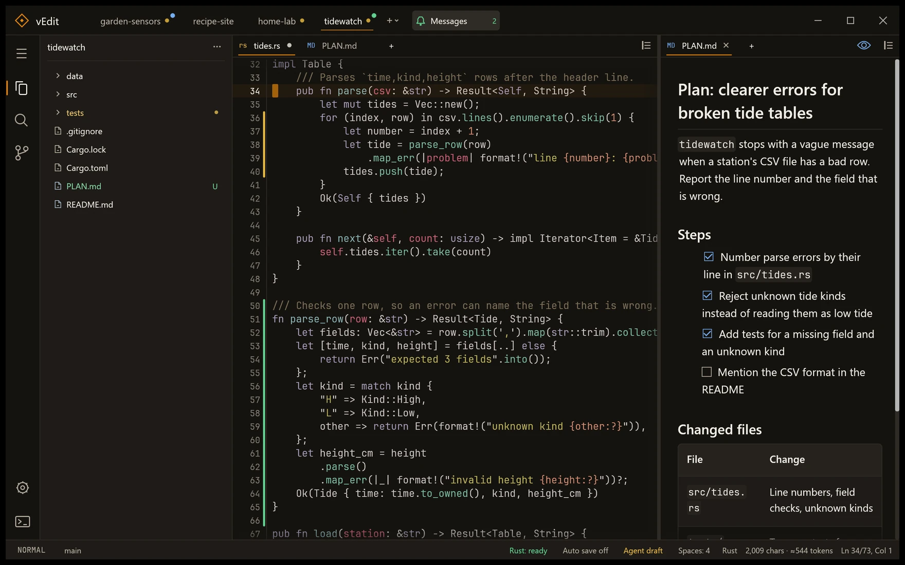
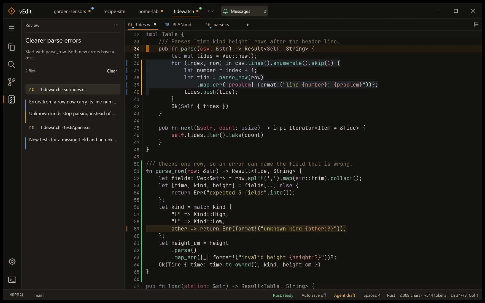
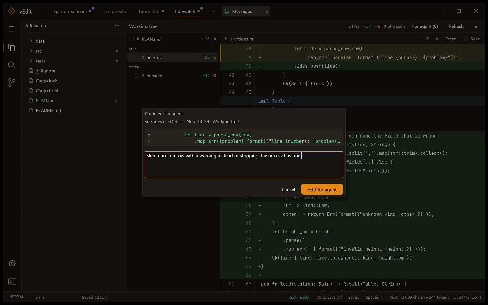
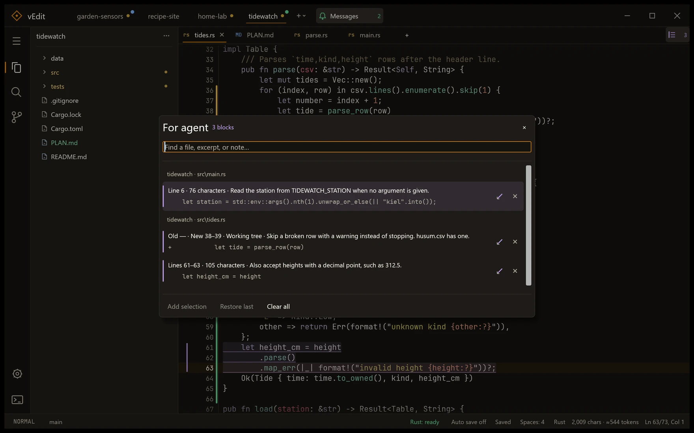

<div align="center">


# vEdit

**A native Windows code editor for working across projects alongside coding agents.**

[](#get-started)
[](https://github.com/emilk/egui)
[](LICENSE)

</div>

Keep all your projects open side by side, let terminal agents such as Claude Code or Codex work in them, and review, comment on and steer their changes in one place. Vim motions, Git and language support for Rust, Python and Dart are built in.



## Features

| | |
| --- | --- |
| **Many projects, one window**<br>Each project keeps its own tabs, splits and layout. Project tabs show uncommitted changes and unread agent messages, and everything comes back after a restart. | **An editor agents can drive**<br>`vedit-cli` opens files, edits open documents, arranges views and starts builds or tests. It answers in JSON with real tab IDs and revisions. |
| **Change review**<br>Read the working tree, a commit or a whole branch as one continuous diff. Mark files as seen, then select lines and leave comments for the agent. | **Agent marks**<br>Select code in any file, press `Ctrl+Shift+A` and add a note. Your agent collects the marks with their exact excerpts through `vedit-cli agent-marks take`. |
| **Agent drafts stay unsaved**<br>Agent edits wait as drafts until you save them, even with autosave on. When an agent writes a file you haven't touched, vEdit reloads it as one undoable step. | **Messages**<br>Agents report when they are done, stuck or need a decision. The message links to a file or a change review and survives restarts. |
| **Vim built in**<br>Motions, text objects, surround, Visual Block, `.` repeat, a leader key, bookmarks and an on-screen jump. Multicursor works too, and Vim can be switched off. | **Git and worktrees**<br>Source control panel, change markers in the gutter, a history graph and branch switching. Worktrees of a repository open as their own projects. |
| **Language support**<br>Diagnostics, completion and go to definition for Rust (rust-analyzer), Python (bundled basedpyright) and Dart, plus hover, references and symbol search where the server offers them. | **Run and launch**<br>Check, test, build or run per project, with clickable error locations. Agents can set up launch options that you start from a Run button. |

## Get started

**From a release.** Download the zip from [Releases](https://github.com/Vironnimo/vEdit/releases), extract it and run its installer:

```powershell
powershell.exe -NoProfile -ExecutionPolicy Bypass -File .\scripts\install.ps1
```

This installs vEdit to `%LOCALAPPDATA%\Programs\vEdit`, adds a Start menu entry and puts `vedit` and `vedit-cli` on your user PATH. Run the same command from a newer package to update. The installer checks the package against its manifest first. Restart open terminals and agent apps so they pick up the new PATH. vEdit also runs portably from the extracted folder.

**From source.** With the stable Rust toolchain for Windows:

```powershell
cargo build --release
.\target\release\vedit.exe
```

Run `scripts\install.ps1` from the checkout to build the full package, with the bundled Python language server, and install it. This needs Node and npm.

You need `git` on PATH for the Git features. Rust support uses `rust-analyzer` (`rustup component add rust-analyzer rust-src`), and Dart support uses an installed Dart or Flutter SDK.

## Working with agents

vEdit doesn't run agents. Start them in a terminal as usual, and they use `vedit-cli` to show you their work. The bundled [vEdit skill](.agents/skills/vedit/SKILL.md) teaches an agent the CLI. It ships in the package under `skills/vedit/`, so pointing your agent at it is enough.

```powershell
vedit-cli open plan.md --preview                          # show a document
vedit-cli review review.json                              # files with notes, in a Review sidebar
vedit-cli review --working                                # open the change review
vedit-cli notify "Tests pass." --title "Parser done" --level success --review working
vedit-cli agent-marks take                                # collect your marks and comments
```

Agent edits need the revision from the previous answer, so an agent can't overwrite text it hasn't seen. Project commands such as builds, tests, search and change reviews use the project the agent works in, not the one on screen, so several agents can work in different projects or worktrees at once.



## Reviewing changes

The change review replaces the editor with one diff of everything that changed. `n` and `p` move between files, `Space` marks a file as seen, and `Enter` opens it at the visible line. To give feedback, select diff lines and press `c`. The comment joins your Agent marks together with the exact excerpt and both line ranges.



Agent marks collect feedback from anywhere: diff comments, lines in any open file, each with an optional note. The agent reads them with `vedit-cli agent-marks`, and `Restore last` brings back what it took.



## Many projects and worktrees

Project tabs sit in the title bar. A yellow dot means uncommitted changes, and a colored dot means an unread message. `Ctrl+Alt+P` lists open projects together with unopened worktrees of the current repository, with branch and change status, so one click opens a worktree as its own project. Files from outside any project land in **Other files**.

## Security

The CLI talks to the running editor over a loopback connection with a random token per session. The token is stored in your user profile. Any program running under your Windows account can therefore do what `vedit-cli` can. It can read and edit open documents, save files, switch Git branches and run project tasks and launch options. That is the same trust you already give a terminal agent: vEdit doesn't sandbox agents. Please report vulnerabilities as described in [SECURITY.md](SECURITY.md).

## Documentation

| Document | Contents |
| --- | --- |
| [Benutzerhandbuch](docs/handbuch.md) | The full user manual, in German |
| [vEdit skill](.agents/skills/vedit/SKILL.md) | How an agent drives vEdit through `vedit-cli` |
| [Development](docs/development.md) | Building, testing, packaging and visual references |
| [Changelog](docs/changelog.md) | Release notes, in German |
| [Documentation index](docs/README.md) | Technical documentation and earlier reports |

`vedit-cli --help` and `vedit-cli <command> --help` describe every command.

## Status

vEdit is in active development and runs on Windows only. Versions are 0.x, so settings and CLI details may still change between releases. It has no debugger and no extension marketplace.

## License

[MIT](LICENSE). Bundled fonts, the Python language server, Node and patched dependencies keep their own licenses, which the package ships under `licenses/`.
